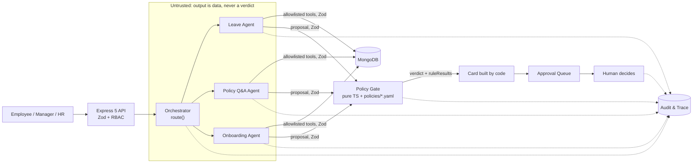

# Architecture

Condensed from [brief.md](brief.md) §4. If the two disagree, the brief wins. Fix this file. Decisions are in [adr/](adr/).

## Components

| Component          | Responsibility                                                                                                                                                                               |
| ------------------ | -------------------------------------------------------------------------------------------------------------------------------------------------------------------------------------------- |
| Web UI             | React + Vite. Employee chat, approval queue, audit and evals views. Renders verdicts; never computes them                                                                                    |
| API                | Express 5 with Zod validation middleware ([ADR-0001](adr/0001-express.md)). Zod on every request and response; RBAC from the `x-demo-user` header ([ADR-0005](adr/0005-demo-user-header.md)) |
| Orchestrator agent | Classifies a message as `leave`, `policy_qa`, `onboarding`, `prohibited`, `out_of_scope` or `unclear`. Only tool: `route()`                                                                  |
| Leave Agent        | Extracts the request and submits it to the gate. Tools: `get_my_balance`, `get_holidays`, `get_team_calendar`, `submit_to_gate`                                                              |
| Policy Q&A Agent   | Answers from the handbook with citations ([ADR-0003](adr/0003-handbook-in-context-with-citations.md))                                                                                        |
| Onboarding Agent   | Builds checklists from role templates. Tools: `get_template`, `create_checklist`, `propose_deviation`                                                                                        |
| Policy Gate        | Pure TypeScript over versioned YAML in `policies/` ([ADR-0004](adr/0004-deterministic-policy-gate.md))                                                                                       |
| Approval Queue     | Managers and HR act on pending items                                                                                                                                                         |
| MongoDB            | Users, requests, checklists, audit trail ([ADR-0002](adr/0002-mongodb.md))                                                                                                                   |
| Audit & Trace      | Every agent step, tool call, gate result and human action, with PII redacted                                                                                                                 |

## Request flow

1. An employee sends a message.
2. The orchestrator classifies it and routes it to one sub-agent.
3. The sub-agent gathers details using only its allowed tools.
4. The Policy Gate computes the verdict from the YAML rules.
5. Code builds the card. The verdict and rule results are copied from the gate; the model writes only the summary sentence.
6. A human decides, or the employee is asked for more detail.
7. Every step is written to the audit trail.



## Trust boundary

- **Untrusted:** user text, uploaded documents and everything an LLM outputs. It is wrapped as data and never followed as instructions.
- **Trusted:** our code, the Policy Gate and the YAML in `policies/`.
- **Crossing the boundary:**
  - Zod parses every crossing, including HTTP, tool inputs and outputs, and agent output.
  - Each agent's tool allowlist is enforced in code. A call outside it throws and ends the run.
  - No approve, compensation, termination or edit-other-employee tool exists.
  - The verdict comes only from the gate, and code copies it onto the card.
  - The server enforces RBAC. The UI only hides things.

## Repo layout

```
server/src/          API server source; *.test.ts files sit next to the code
web/src/             React UI; *.test.ts(x) files sit next to the code
scripts/             repo tooling (test-one.mjs)
.claude/hooks/       Claude Code hooks + their tests (human-edited only)
.claude/agents/      dev subagents: spec-writer, test-writer, reviewers (docs/dev-agents.md)
.claude/skills/      workflow skills: new-feature, run-evals, change-policy, fix-issue, open-pr
.claude/rules/       path-scoped rules: gate, agents, web
.husky/pre-commit    git hook: lint-staged, then gitleaks on staged changes
.github/             CI workflow (human-edited only), CODEOWNERS, PR template
docs/                brief.md, architecture.md, ai-policy.md, dev-agents.md, mcp-inventory.md
docs/adr/            architecture decision records
README.md            clone-to-green and a where-to-find-what map
AI_LOG.md            daily log of AI use, failures and the rules they led to
specs/               _template.md; one spec per feature, written before code
CONTRIBUTING.md      setup, npm scripts, branch/PR rules, commit convention
tsconfig.base.json   shared strict compiler options
eslint.config.js     lint rules (typescript-eslint strictTypeChecked)
vitest.config.ts     test projects: server, web
docker-compose.yml   local MongoDB
.env.example         env template; copy to .env, never commit real values
```

## Module layout (planned)

Planned in brief §9. Most parts don't exist yet; the notes say which do. Create each part only when its first spec needs it.

- `server/src/gate/`: Policy Gate, pure functions over `policies/` with no I/O, clock or LLM.
- `server/src/agents/`: orchestrator and sub-agents with code-enforced tool allowlists.
- `policies/`: versioned YAML rules, validated with Zod. `policies/leave/v1.yaml` exists; its schema is `server/src/gate/leave-policy.schema.ts` (spec leave-policy).
- `server/src/http/`: Express 5 app, typed Zod route helper, `x-demo-user` identity ([ADR-0005](adr/0005-demo-user-header.md)) and error contract; `server/src/http/approvals/` holds the approval queue and audit trace routes, their ports and in-memory fakes (spec approval-queue).
- `server/src/intake/`: `POST /messages` and `GET /my-requests`. Dispatches a message through the orchestrator to the Leave Agent and turns a card into a pending `LeaveRequest` plus one `ApprovalItem`; ports and in-memory fakes (spec request-intake). Mounted through `createApp`'s `extraRoutes`, so `server/src/http/` still imports no agent code.
- `server/src/chat/`: `POST /chat` and `GET /conversations/:id`. A conversation belongs to one user; with no active task the orchestrator classifies the message, and with an active Leave task the Leave Agent continues from a code-rendered draft. Shares the intake dispatcher (`server/src/intake/dispatch.ts`) and stores; ports and the in-memory store sit here, `MongoConversationStore` in persistence (spec chat-endpoint). Mounted through `createApp`'s `extraRoutes`.
- `server/src/persistence/mongo/`: MongoDB adapters for every port (directory, approvals, leave requests and message owners, append-only audit, idempotency, leave data), the two storage-only models and `connectMongo` (spec mongo-persistence). Outside `server/src/http/`.
- `server/src/server/`: process wiring: `startServer` (policy, env, production refusal, prompt files, model client, MongoDB, app, listen on `127.0.0.1`, graceful shutdown), `buildApp`, `listenHttp`, the system clock and `uuidIdGen` (spec mongo-persistence). `server/src/index.ts` only passes the production deps.
- `server/src/policies/`: the boot-time policy loader (read, SHA-256, YAML parse, validate). It does I/O, so it sits outside the gate.
- `prompts/`: versioned agent prompts.
- `evals/`: labeled eval cases and thresholds.
- `shared/`: Zod schemas used by both server and web. Until web needs them, the domain schemas live in `server/src/domain/` (spec domain-schemas D-1).
- `web/src/`: employee chat, approval queue, audit and evals views.
