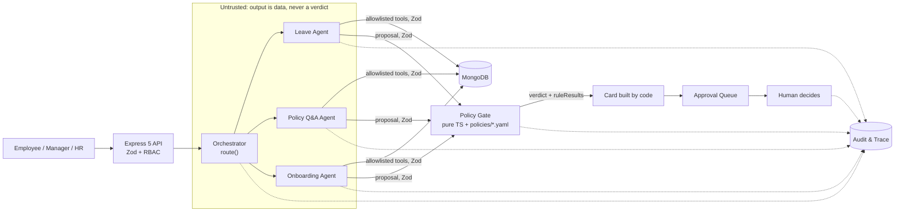

# Architecture

Condensed from [brief.md](brief.md) §4. If the two disagree, the brief wins. Fix this file. Decisions are in [adr/](adr/).

## Components

| Component          | Responsibility                                                                                                                                                                               |
| ------------------ | -------------------------------------------------------------------------------------------------------------------------------------------------------------------------------------------- |
| Web UI             | React + Vite. Employee chat, approval queue, audit and evals views. Renders verdicts; never computes them                                                                                    |
| API                | Express 5 with Zod validation middleware ([ADR-0001](adr/0001-express.md)). Zod on every request and response; RBAC from the `x-demo-user` header ([ADR-0005](adr/0005-demo-user-header.md)) |
| Orchestrator agent | Classifies a message as `leave`, `policy_qa`, `onboarding`, `prohibited`, `out_of_scope` or `unclear`. Only tool: `route()`                                                                  |
| Leave Agent        | Extracts the request and submits it to the gate. Tools: `get_my_balance`, `get_holidays`, `get_team_calendar`, `submit_to_gate`                                                              |
| Policy Q&A Agent   | Answers from the handbook with citations ([ADR-0003](adr/0003-handbook-in-context-with-citations.md))                                                                                        |
| Onboarding Agent   | Builds checklists from role templates. Tools: `get_template`, `create_checklist`, `propose_deviation`                                                                                        |
| Policy Gate        | Pure TypeScript over versioned YAML in `policies/` ([ADR-0004](adr/0004-deterministic-policy-gate.md))                                                                                       |
| Approval Queue     | Managers and HR act on pending items                                                                                                                                                         |
| MongoDB            | Users, requests, checklists, audit trail ([ADR-0002](adr/0002-mongodb.md))                                                                                                                   |
| Audit & Trace      | Every agent step, tool call, gate result and human action, with PII redacted                                                                                                                 |

## Request flow

1. An employee sends a message.
2. The orchestrator classifies it and routes it to one sub-agent.
3. The sub-agent gathers details using only its allowed tools.
4. The Policy Gate computes the verdict from the YAML rules.
5. Code builds the card. The verdict and rule results are copied from the gate; the model writes only the summary sentence.
6. A human decides, or the employee is asked for more detail.
7. Every step is written to the audit trail.



## Trust boundary

- **Untrusted:** user text, uploaded documents and everything an LLM outputs. It is wrapped as data and never followed as instructions.
- **Trusted:** our code, the Policy Gate and the YAML in `policies/`.
- **Crossing the boundary:**
  - Zod parses every crossing, including HTTP, tool inputs and outputs, and agent output.
  - Each agent's tool allowlist is enforced in code. A call outside it throws and ends the run.
  - No approve, compensation, termination or edit-other-employee tool exists.
  - The verdict comes only from the gate, and code copies it onto the card.
  - The server enforces RBAC. The UI only hides things.

## Repo layout

```
server/src/          API server source; *.test.ts files sit next to the code
web/src/             React UI (specs/web-shell.md, specs/employee-chat.md, specs/approval-queue-ui.md, specs/onboarding-ui.md); *.test.ts(x) files sit next to the code
shared/src/          @hr/shared: re-exports the server's HTTP contract schemas for web (specs/web-shell.md)
scripts/             repo tooling (test-one.mjs, dev-metrics.ts)
e2e/                 Playwright demo suite (spec e2e-demo): demo.e2e.ts, helpers.ts, recordings/ (committed model replies); screenshots/ is gitignored
.claude/hooks/       Claude Code hooks + their tests (human-edited only)
.claude/agents/      dev subagents: spec-writer, test-writer, eval-drafter, reviewers (docs/dev-agents.md)
.claude/skills/      workflow skills: new-feature, run-evals, change-policy, fix-issue, open-pr
.claude/rules/       path-scoped rules: gate, agents, web
.husky/pre-commit    git hook: lint-staged, then gitleaks on staged changes
.github/             CI and eval workflows (human-edited only; docs/ci-agents.md), CODEOWNERS, PR template
docs/                brief.md, architecture.md, ai-policy.md, dev-agents.md, ci-agents.md, mcp-inventory.md
docs/adr/            architecture decision records
handbook/            synthetic employee handbook (HB-x.y section IDs); Policy Q&A source (ADR-0003)
README.md            clone-to-green and a where-to-find-what map
AI_LOG.md            daily log of AI use, failures and the rules they led to
specs/               _template.md; one spec per feature, written before code
CONTRIBUTING.md      setup, npm scripts, branch/PR rules, commit convention
tsconfig.base.json   shared strict compiler options
eslint.config.js     lint rules (typescript-eslint strictTypeChecked)
vitest.config.ts     test projects: server, web
docker-compose.yml   local MongoDB
.env.example         env template; copy to .env, never commit real values
```

## Module layout (planned)

Planned in brief §9. Most parts don't exist yet; the notes say which do. Create each part only when its first spec needs it.

- `server/src/gate/`: Policy Gate, pure functions over `policies/` with no I/O, clock or LLM.
- `server/src/agents/`: orchestrator and sub-agents with code-enforced tool allowlists.
- `policies/`: versioned YAML rules, validated with Zod. `policies/leave/v1.yaml` exists; its schema is `server/src/gate/leave-policy.schema.ts` (spec leave-policy).
- `server/src/gate/qa.ts`: the Policy Q&A gate (`evaluateQa`), pure. It verifies that citations are verbatim and sit inside `HB-n.m` sections, and checks for sensitive topics. Its YAML is `policies/qa/v1.yaml`, validated by `server/src/gate/qa-policy.schema.ts` (spec policy-qa).
- `server/src/domain/handbook.ts` and `server/src/domain/qa.ts`: pure handbook helpers (body, sections, whitespace normalisation) and the shared Q&A schemas (`QaGateResult`, `PolicyQuestion`, `PolicyQuestionStore`). They sit in `domain/` so `server/src/http/` can use them without importing `/gate/` (spec policy-qa DD-23).
- `server/src/agents/policy_qa/`: the Policy Q&A Agent. It makes one Claude call with the handbook as a cached, citation-enabled document, with no tools and no tool loop. It parses the response at the boundary, then calls the Q&A gate (spec policy-qa). Dispatch writes a `PolicyQuestion` and an `escalation` item on `ESCALATE_TO_HR`. HR sees the question in the queue and closes the item with `resolve`.
- Onboarding (spec onboarding):
  - `server/src/gate/onboarding.ts` (`evaluateOnboarding`) is the pure onboarding gate. It returns `AUTO` only when the checklist equals the role template and nothing was proposed; any added or removed task gives `MANAGER`.
  - The role templates are in `policies/onboarding/v1.yaml`, validated by `server/src/gate/onboarding-policy.schema.ts`.
  - `server/src/domain/onboarding.ts` holds the pure checklist builder, `applyDeviation`, the deviation schemas and the `OnboardingStore` port.
  - `server/src/agents/onboarding/` is the Onboarding Agent. Its only tools are `get_template`, `create_checklist` and `propose_deviation`, and none of them writes anything.
  - Dispatch creates the template checklist plus one `onboarding_deviation` item per proposed deviation. A deviation lands on the checklist only when the assigned manager approves it in the approval queue.
  - `server/src/onboarding/` holds the onboarding API (spec onboarding-api): `POST /onboarding` (code builds the checklist; a notes-mode agent only proposes deviations), `GET /onboarding`, `GET /onboarding/:checklistId` and `PATCH /onboarding/:checklistId/tasks/:taskId` (done, blocked or reopen), plus the in-memory store. `MongoOnboardingStore` is in persistence.
- `server/src/http/`: Express 5 app, typed Zod route helper, `x-demo-user` identity ([ADR-0005](adr/0005-demo-user-header.md)) and error contract; `server/src/http/approvals/` holds the approval queue and audit trace routes, their ports and in-memory fakes (spec approval-queue). Leave subject views carry `workingDays`, computed at read time through the `holidays` port and the pure `countWorkingDays` in `server/src/domain/calendar.ts`, which the leave gate also calls (spec approval-queue-ui).
- `server/src/intake/`: `POST /messages` and `GET /my-requests`. Dispatches a message through the orchestrator to the Leave Agent and turns a card into a pending `LeaveRequest` plus one `ApprovalItem`; ports and in-memory fakes (spec request-intake). Mounted through `createApp`'s `extraRoutes`, so `server/src/http/` still imports no agent code.
- `server/src/chat/`: `POST /chat` and `GET /conversations/:id`. A conversation belongs to one user; with no active task the orchestrator classifies the message, and with an active Leave task the Leave Agent continues from a code-rendered draft. Shares the intake dispatcher (`server/src/intake/dispatch.ts`) and stores; ports and the in-memory store sit here, `MongoConversationStore` in persistence (spec chat-endpoint). Mounted through `createApp`'s `extraRoutes`.
- `server/src/handbook/`: `GET /handbook/sections/:id` (spec `specs/employee-chat.md`, rule 14). Read-only, any authenticated role. It serves `body.slice(section.start, section.end)` from the handbook body loaded at boot, the same text the Q&A gate checks citations against. No store, model call or audit event. `schemas.ts` imports only zod and `domain/handbook.ts`, so `@hr/shared` re-exports its response. Mounted through `createApp`'s `extraRoutes`.
- `server/src/persistence/mongo/`: MongoDB adapters for every port (directory, approvals, leave requests and message owners, append-only audit, idempotency, leave data), the two storage-only models and `connectMongo` (spec mongo-persistence). Outside `server/src/http/`.
- `server/src/server/`: process wiring: `startServer` (policy, env, production refusal, prompt files, model client, MongoDB, app, listen on `127.0.0.1`, graceful shutdown), `buildApp`, `listenHttp`, the system clock and `uuidIdGen` (spec mongo-persistence). `server/src/index.ts` only passes the production deps.
- `server/src/metrics/`: `GET /metrics/agents`, hr_admin only (spec agent-metrics). The pure `aggregate` turns the request-summary audit events (`intake_outcome`, `chat_turn`, `onboarding_created`, `onboarding_create_escalated`) into counts by route, the three verdict distributions, the escalation rate and cost. It reads them through the `AuditSummaryReader` port. `requestUsage` (`usage.ts`) reads a request's own model-call events back, so each summary event records its token and USD `usage`.
- `server/src/audit-view/`: the read-only audit view routes (spec `specs/audit-view.md`). `GET /audit/:requestId/timeline` reads the trace through `readVisibleTrace` (`server/src/http/approvals/trace.ts`, shared with `GET /audit/:requestId`) and projects each event into an allowlisted, redacted `TimelineStep` (pure `timeline.ts`). `GET /evals/history` and `GET /build-notes` are hr_admin only: they read `evals/results/`, `docs/dev-metrics.md` and `AI_LOG.md` from fixed boot paths (`fs-readers.ts`, the module's only file I/O) and return eval summaries and server-built markdown blocks. No writes, no model calls, no gate imports.
- `server/src/lib/cost.ts`: the pure pricing rule (`Pricing`, `priceEvents`), shared by the eval runner and the server. Both read `evals/pricing.yaml`, and the server refuses to start if any shipped agent model has no price.
- `server/src/policies/`: the boot-time policy loader (read, SHA-256, YAML parse, validate). It does I/O, so it sits outside the gate.
- `server/src/e2e/`: the e2e server entry (spec e2e-demo). `main.ts` runs `runE2e` (`cli.ts`): it derives and seeds a fresh `hr_e2e_<hex>` database, then calls `runServerProcess` with a replay `ModelClient` (`replay-model.ts`, keyed by a normalised request hash over `e2e/recordings/`; a miss throws and never reaches the network) or, owner only, a recording wrapper (`record-model.ts`), and wraps `buildApp` with a frozen-date clock (`clock.ts`, 2026-11-09). `start.ts` is unchanged. Imports nothing from `server/src/gate/`.
- `server/src/evals/`: the eval runner behind `npm run evals` (spec eval-runner). Runs each case on a fresh in-memory world seeded from the fixtures, through the production agents and `buildApp` called in-process, scores in code (`score/`, never a model), prices each case's model calls from `evals/pricing.yaml`, and writes one `evals/results/<date>-<agent>-<promptVersion>.json` per agent. Imports nothing from `server/src/gate/`.
- `prompts/`: versioned agent prompts.
- `evals/`: labeled eval cases, `thresholds.yaml`, `pricing.yaml` and the committed `results/` of each run.
- `shared/`: the `@hr/shared` workspace, a thin facade over the server's Zod schemas (spec `specs/web-shell.md` D-2, amending domain-schemas D-1). `shared/src/api.ts` only re-exports the HTTP contract (chat, approvals, audit trace, error body, `MAX_USER_TEXT_CHARS`, domain enums; plus `MyRequestsResponse`, `SectionId` and `HandbookSectionResponse` from `specs/employee-chat.md`) from `server/src/`; no schema moves, and a test keeps its import graph zod-only so it bundles for the browser.
- `web/src/`: the web shell (spec web-shell): a persona switcher that sets `x-demo-user` (Asha `emp-003`, Ravi `emp-002`, Meera `emp-001`; web-only labels), and `/chat`, `/queue`, `/onboarding` and `/audit` routes that parse every response with `@hr/shared`. `/chat` is the employee view (`specs/employee-chat.md`): this session's turns, each with a raw status pill; handbook-section chips on policy answers that open the section as plain text inline; and "My requests" from `GET /my-requests`. `/queue` is the approval queue (`specs/approval-queue-ui.md`): recommendation cards in two tabs (leave requests; escalations and onboarding) with ✓/✗ rule rows, verdict badge, policy version and Approve / Reject / Comment / Resolve, under `web/src/components/approvals/`. `/audit` (`specs/audit-view.md`) has three tabs: the trace timeline from `GET /audit/:requestId/timeline`, eval pass rate over time from `GET /evals/history`, and "How this was built" from `GET /build-notes`, under `web/src/components/audit/`. `/onboarding` (`specs/onboarding-ui.md`) adds a new joiner through `POST /onboarding` and lists the active checklists: tasks grouped by owner, a progress bar, an "N pending approval" count (deviations are decided only in `/queue`) and `Mark done` for the task's owner, under `web/src/components/onboarding/`.
